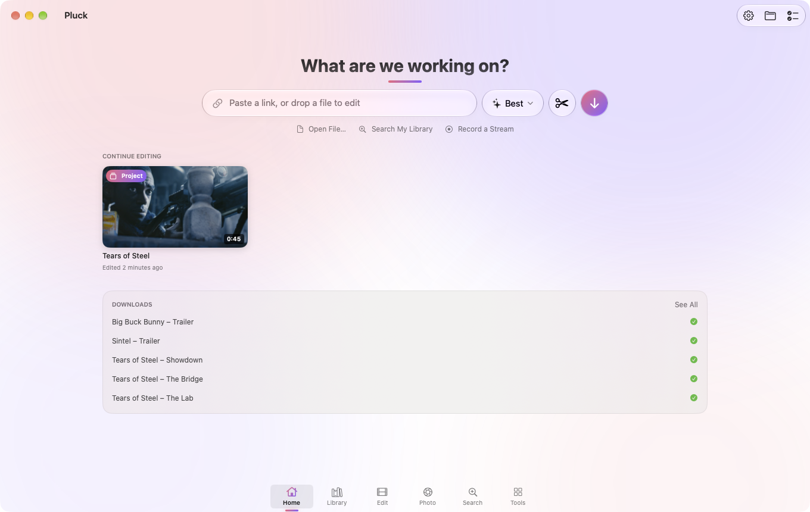
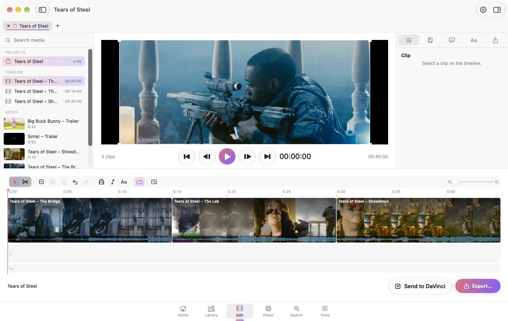
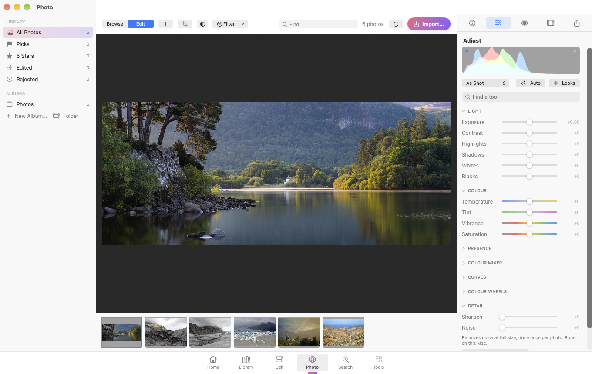
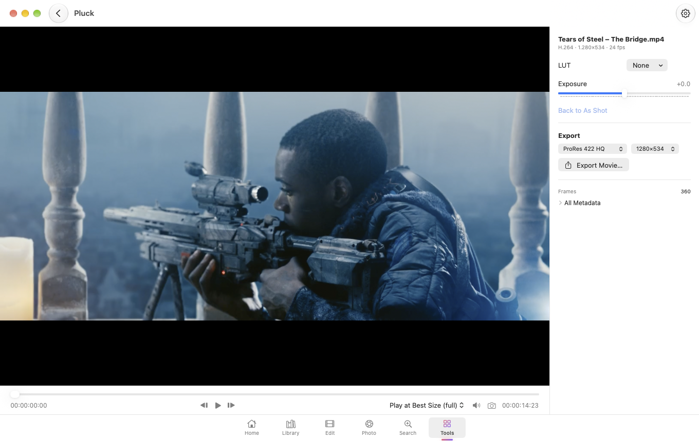
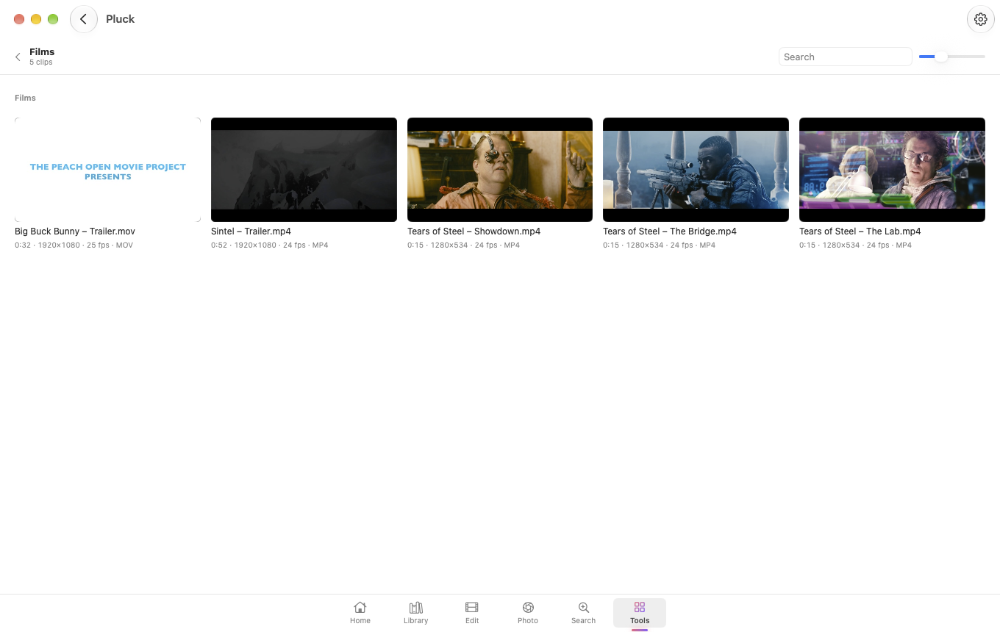
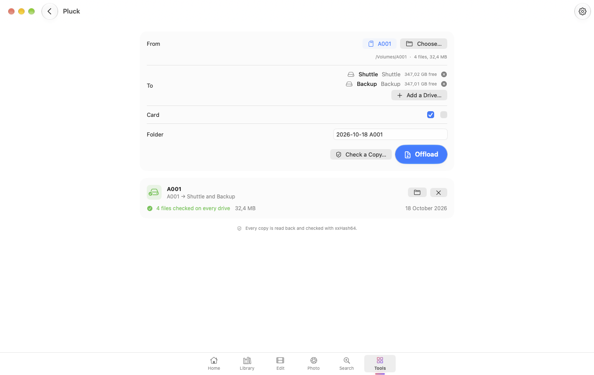
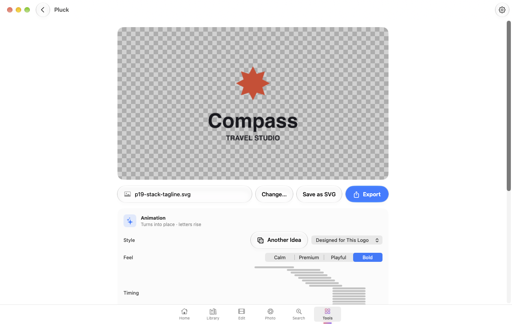
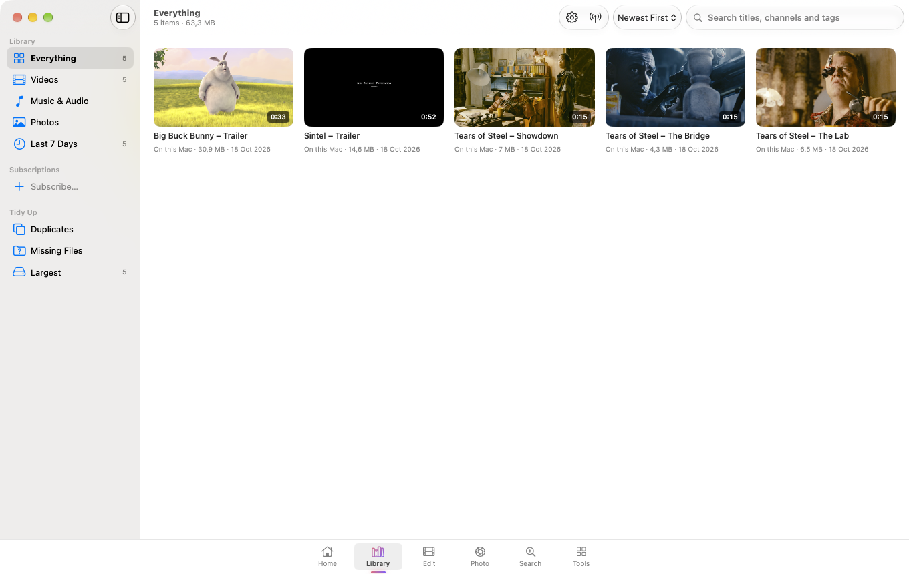
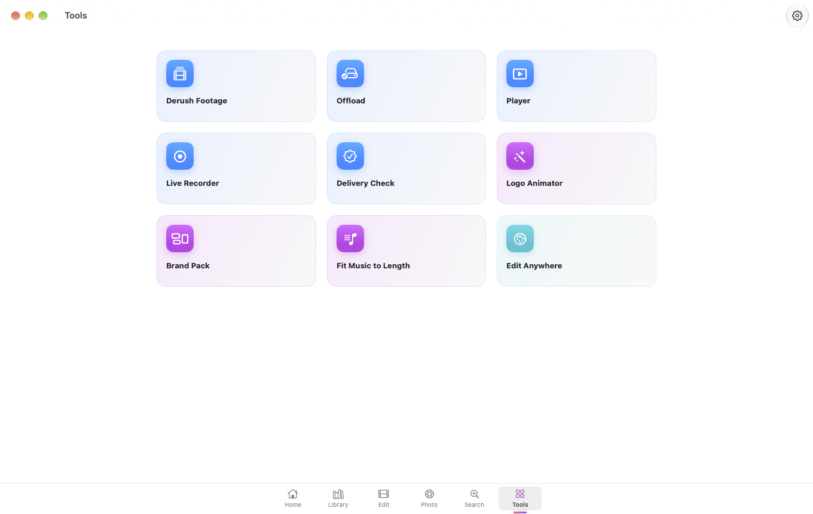
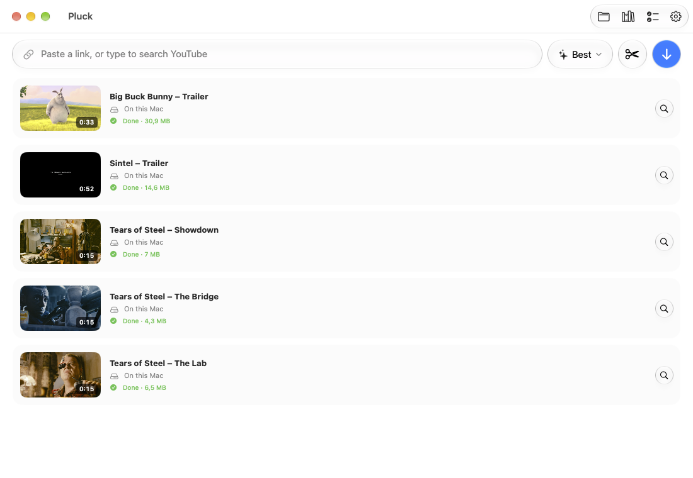

<h1 align="center">Pluck Studio</h1>

<p align="center">
  <b>A creative studio for your Mac. Bring footage in from a link or a card, play camera raw, edit video and photos, animate your logo and check the export before it goes out. Everything runs on your Mac; nothing is uploaded.</b>
</p>

<p align="center">
  <a href="https://github.com/Astrofrogger/pluck/releases/latest/download/Pluck-Studio.dmg"><b>⬇︎ Download Pluck Studio</b></a>
  &nbsp;·&nbsp;
  <a href="https://github.com/Astrofrogger/pluck/releases/latest/download/Pluck.dmg">or just the downloader</a>
  <br>free · macOS 14 or later · Apple silicon & Intel · 10 languages
</p>

<p align="center">
  <a href="https://buymeacoffee.com/astrofrogger"></a>
</p>

<p align="center">
  <picture>
    <source media="(prefers-color-scheme: dark)" srcset="docs/screenshots/home-dark.png">
    
  </picture>
</p>

One window, six pages along the bottom: **Home, Library, Edit, Photo, Search and Tools.** Paste a link or drop a file and pick up where you left off. A native SwiftUI app, with Liquid Glass on macOS 26 and later.

- 🎬 **Edit:** a real timeline, with editing by deleting words from the transcript, cuts on the beat, subtitles, titles and music, then off to DaVinci Resolve or an export
- 📷 **Photo:** cull and develop RAW photos, with masks for the subject, people, sky and depth, film looks and XMP sidecars for Lightroom and Capture One
- 🎞️ **Player:** plays camera raw (.r3d and Blackmagic RAW) smoothly on the Mac's graphics chip, plus ProRes, MXF and image sequences, with a folder browser to skim every clip
- 💾 **Offload:** copies a card to several drives at once, every file read back and checked
- ✨ **Logo Animator & Brand Pack:** an animation designed from your logo's own shapes, plus lower thirds, title and end cards in its colours
- ✅ **Delivery Check:** flash frames, black, frozen picture, dropouts, loudness and typos, found before the client does
- 🔎 **Search:** find a moment by what was said or what's in the picture, across your downloads and footage folders
- ⬇︎ **Download:** video and music from YouTube, Spotify and Apple Music links and 1,800+ sites, into a Library that keeps it all
- 🧠 **Local AI:** subtitles, translations, speakers, summaries, shorts, clean audio, new backgrounds, privacy blur, stems and more, on your Mac

<table>
  <tr>
    <td align="center" width="50%">
      <picture>
        <source media="(prefers-color-scheme: dark)" srcset="docs/screenshots/edit-dark.png">
        
      </picture>
      <br><b>Edit</b><br>Projects and single files, on a full-width timeline.
    </td>
    <td align="center" width="50%">
      <picture>
        <source media="(prefers-color-scheme: dark)" srcset="docs/screenshots/photo-dark.png">
        
      </picture>
      <br><b>Photo</b><br>Cull, then develop, with your originals never changed.
    </td>
  </tr>
  <tr>
    <td align="center" width="50%">
      <picture>
        <source media="(prefers-color-scheme: dark)" srcset="docs/screenshots/player-dark.png">
        
      </picture>
      <br><b>Player</b><br>Camera raw with ISO, white balance, LUTs and timecode.
    </td>
    <td align="center" width="50%">
      <picture>
        <source media="(prefers-color-scheme: dark)" srcset="docs/screenshots/browser-dark.png">
        
      </picture>
      <br><b>Open a folder</b><br>Every clip in it and its subfolders, to skim and scrub.
    </td>
  </tr>
  <tr>
    <td align="center" width="50%">
      <picture>
        <source media="(prefers-color-scheme: dark)" srcset="docs/screenshots/offload-dark.png">
        
      </picture>
      <br><b>Offload</b><br>One card, several drives, every copy checked with xxHash64.
    </td>
    <td align="center" width="50%">
      <picture>
        <source media="(prefers-color-scheme: dark)" srcset="docs/screenshots/logo-dark.png">
        
      </picture>
      <br><b>Logo Animator</b><br>Designed for your logo; change its feel or any part.
    </td>
  </tr>
  <tr>
    <td align="center" width="50%">
      <picture>
        <source media="(prefers-color-scheme: dark)" srcset="docs/screenshots/library-dark.png">
        
      </picture>
      <br><b>Library</b><br>Everything you've saved, with tags, duplicates and missing files.
    </td>
    <td align="center" width="50%">
      <picture>
        <source media="(prefers-color-scheme: dark)" srcset="docs/screenshots/tools-dark.png">
        
      </picture>
      <br><b>Tools</b><br>The rest of the studio, one click away.
    </td>
  </tr>
</table>

## Two editions
**Pluck Studio** is everything on this page. **Pluck** is the lightweight one: downloading video and music, the Library, sharing to your phone and converting files, small and focused. Switch between them any time in Settings → General; your downloads, Library and settings stay.

<p align="center">
  <picture>
    <source media="(prefers-color-scheme: dark)" srcset="docs/screenshots/basic-dark.png">
    
  </picture>
</p>

## Install
Download **[Pluck-Studio.dmg](https://github.com/Astrofrogger/pluck/releases/latest/download/Pluck-Studio.dmg)** (or **[Pluck.dmg](https://github.com/Astrofrogger/pluck/releases/latest/download/Pluck.dmg)** for just the downloader), open it, and drag the app into Applications. The first time you open it, go to System Settings → Privacy & Security and click **Open Anyway**, because the app isn't signed with an Apple Developer ID. After that, Pluck checks GitHub for its own updates and installs them when you click **Install & Relaunch**.

## Pluck Studio

### Edit
- **Projects:** drop several videos and local AI lays out a story across them at the length you choose, or open a single file in a tab
- **A full-width timeline** with waveforms, titles, music and subtitles; move, zoom, crop, speed up, stabilise and colour each clip, with LUTs
- **Edit by text:** delete words from the transcript to cut them, remove filler words and silences, keep only the passages worth telling a story with
- **Cut to the beat, reframe for vertical,** dip to black or white, dynamic zoom with start and end frames, and relink missing media
- **Subtitles your way:** font, weight, size, colour, outline or box, shadow; drag lines on the timeline, add, split or join them
- **Send to DaVinci Resolve** as a new timeline with its subtitles, or export; long renders can be stopped

### Photo
- **Browse and Edit:** ratings, picks, colour labels, albums in folders, Compare two photos zoomed together, burst stacking and quick checks for blur and closed eyes
- **A real RAW developer:** every camera from the same neutral point, profiles, Kelvin white balance with CAT16, highlights and shadows without halos, curves, colour mixer and wheels, dehaze, live histogram and clipping warnings
- **Masks:** subject, people, objects, sky, depth, gradients, brush and brightness or colour ranges, combined as you like; found by AI on your Mac
- **Looks** with live previews, snapshots, selective paste, Match Exposure, crop with rotation, optional AI denoise, and **XMP sidecars** for Lightroom and Capture One
- **Real film:** [spektrafilm](https://github.com/andreavolpato/spektrafilm) simulates film stock, paper, grain and halation from measured data, an optional 9 MB download (GPLv3)

### Player
- **Camera raw:** .r3d and Blackmagic RAW, decoded on the Mac's graphics chip, with ISO, white balance, LUTs, timecode and sound; ProRes, MXF and image sequences too
- **Open a folder** to see every clip in it and its subfolders as a thumbnail, with search, and scrub through them
- **Export** to ProRes, HEVC or H.264 at the size you choose, save the frame on screen, and press Space in Finder to preview raw clips

### Offload
- **One card to several drives at once,** every file read back and checked against the original with xxHash64, and an MHL for each copy
- A drive that's pulled out **picks up where it stopped;** check any copy later against its MHL, and get a report for the production

### Logo Animator & Brand Pack
- **The Logo Animator** reads your logo like a motion designer: it takes it apart into its shapes, finds the symbol, the name and the tagline, and designs an animation for it. Pick a feel (calm, premium, playful or bold), ask for another idea, or change when and how any part comes in
- **Export** a reveal, intro, sting, loop or still, up to 4K, in 16:9, 9:16, square or 4:5, with transparency (ProRes 4444 or HEVC) and a sound on the moment the logo lands
- **Brand Pack** makes lower thirds (one per name, all at once), a title card and an end card in your logo's colours, animated and transparent

### Delivery Check
Drop a finished export and Pluck looks it over before it goes out: flash frames, black, a frozen picture, sound dropping out, loudness for where it's going (online, social, broadcast in Europe or the US), typos in titles and text too close to the edge. Each finding opens at its moment.

### Search
Find a moment by what was said and by what's in the picture, in your own language, across your downloads and the footage folders you point Pluck at (⇧⌘F). **Find Shots** can write what it sees into your DaVinci Resolve project: a description, keywords and a marker per shot.

### More tools
- **Derush Footage:** local AI looks at every shot of a shoot and builds a first selection and timeline in Resolve
- **Live Recorder:** record a live stream from the start or from now
- **Fit Music to Length:** a song cut to land exactly on time, from a few seconds to many minutes
- **Edit Anywhere:** render DaVinci Resolve timelines on another Mac from anywhere, with the originals on its storage, fetch proxies or originals, and search its footage. Everything stays on your own private network

## Downloading and converting
In both Pluck and Pluck Studio; Local AI is Pluck Studio's.

### Getting things in
- **Paste a link** (Pluck fills it in from the clipboard when you switch to it), drag one onto the window, or **type words to search** YouTube Music (songs) or YouTube (videos)
- **Many links at once:** paste several links (one per line or separated by spaces), drop a list of links or selected text, or choose File → Download Links from File… to read them from a text file
- **Playlists:** paste a YouTube playlist, or a Spotify or Apple Music album or playlist, and pick what you want. Items you already have are marked
- **From any app:** a shortcut you choose (⌃⌥⌘D by default) downloads the link you copied, without switching to Pluck. Or right-click a link or text and choose **Services → Download with Pluck**
- **From your browser:** a one-click bookmark (see below) sends the page you're on to Pluck
- **Spotify:** track, album and playlist links. Spotify audio is DRM-protected, so Pluck finds the matching song on YouTube Music and tags the file with Spotify's title, artist, album and a square cover
- **Apple Music:** song, album and public playlist links. Like Spotify, the audio is matched on YouTube Music; the file gets Apple's title, artist, album, track number, year and 1500 px album art. (Apple's playlist pages show about the first 50 songs.)
- **Almost any website:** yt-dlp supports 1,800+ sites. When it doesn't recognise a page, Pluck loads the page in an invisible browser, lets the player start (muted) and downloads the stream it finds, including embedded Vimeo, YouTube, Dailymotion, Twitch and SoundCloud players. DRM-protected streams are never downloaded. Sites that need a login use your browser's cookies (Safari, Chrome, Firefox, Zen, Brave, Edge, Vivaldi, Opera or Chromium)

### Quality
- **Video:** Best, 4K, 1440p, 1080p, 720p, 480p or 360p, in H.264 (plays everywhere) or AV1/VP9, as MP4, MKV or WebM, optionally preferring 60 fps
- **Audio:** original, M4A, MP3, Opus, FLAC or WAV. Pluck takes the best source and only converts when it has to. With YouTube Premium (and your browser's cookies) that's about 256 kbps instead of 128. Every download shows the quality it actually got
- **Clips:** click the scissors to download only part of a video, e.g. from 1:30 to 2:45
- **Split into chapters:** turn it on in the format menu and videos with chapters (DJ mixes, full albums) are saved as one file per chapter, each tagged with its own title and track number
- **Lossless badge:** shown when the audio stayed lossless from the source to your file. A FLAC made from a lossy stream doesn't get it

### Music
- **Lyrics** from [LRCLIB](https://lrclib.net) are written into MP3, M4A and FLAC files, so they show up in Apple Music and on iPhone
- **Add to Apple Music:** turn it on in Settings → Downloads to add every song you download, or only the file types you pick (M4A, MP3, WAV, AIFF, MP4, M4V, MOV). With *All songs*, FLAC gets an Apple Lossless copy and Opus/WebM an AAC copy, since Apple Music can't import those. Your original files stay where they are
- **Cover art and tags** (title, artist, album) are embedded automatically

### Local AI (Pluck Studio)
Everything here runs **locally on your Mac**: Apple's on-device speech recognition, translation, voice isolation, video processing and Apple Intelligence, plus open-source models for stems and speakers. Nothing you download, say or search is uploaded. Click the ✨ button on a finished download, or drop a video or song from your Mac on the window to use these on your own files. Select several items (⌘ or ⇧) to add subtitles, remove silences or clean up the audio of all of them at once:
- **Subtitles & transcripts:** transcribe any video or song, save an `.srt`, add subtitle tracks to the video or burn them into the picture, and translate them into one or more other languages
- **Translate subtitle files:** drop an `.srt` or `.vtt` on Pluck to translate it into one or more languages; the translations are saved next to it
- **Who said what:** up to four speakers are told apart; subtitles and transcripts show their names (rename them in the Editor) and summaries know who said what. The speaker model (about 230 MB, NVIDIA Sortformer) is downloaded the first time
- **Remove silences & fillers:** cuts long pauses and filler words like "uhm" into a tightened copy, at a tight, natural or relaxed pace. For editing, it can also save an EDL with the same cuts for DaVinci Resolve or Premiere Pro
- **Clean up audio:** removes background noise, hum and wind around voices with Apple's voice isolation, then levels the loudness for online video (−14 LUFS), podcasts (−16) or broadcast (−23). The picture is copied untouched
- **Upscale & smooth:** makes low-resolution video sharp in 1080p or 4K, and adds frames for twice as smooth motion or 2× and 4× slow motion
- **New background:** separates people from what's behind them, no green screen needed: blur the background, replace it with a colour or picture, or make it transparent (ProRes 4444) for your editor
- **Privacy blur:** finds faces and follows them through the video, and blurs or pixelates everyone except the people you keep sharp, optionally text like licence plates too
- **Search inside downloads** (⇧⌘F): find what was said and jump straight to that moment. Turn on automatic transcripts in Settings → AI so new downloads are searchable
- **Summaries & chapters:** a short summary with key points, and chapters for videos without them (written into the file, so QuickTime and Apple Music show them)
- **Shorts:** 1–5 vertical 9:16 clips from a long video. Local AI picks the best moments, each shot is framed steadily on the speaker or subject (titles are shown whole), and the spoken word is highlighted
- **Caption styles:** for shorts and burned-in subtitles, choose a highlight box or colored text, the color, a size and a font, including your own fonts
- **Stems & karaoke:** split a song into vocals, drums, bass and other, plus an instrumental (karaoke) version. The model (168 MB, [HTDemucs](https://github.com/facebookresearch/demucs), MIT) is downloaded the first time and checked
- **Transcript beside the video:** in the Editor, watch with the transcript, summary and chapters beside the video; click a line to jump there. Export the transcript as text, Markdown or Word, or save the frame on screen as a picture
- **Spoken language:** for your own files, Pluck asks which language is spoken before it writes a transcript, so summaries, chapters and shorts get it right

Requirements: transcripts, subtitles, search, shorts, filler words and upscaling need macOS 26 or later; summaries, chapters and the smartest search and shorts also need Apple Intelligence; speaker labels need Apple silicon; stems need macOS 27 on Apple silicon. Removing silences, cleaning up audio, new backgrounds and privacy blur work on every supported Mac. Features a Mac can't run are simply hidden. Third-party licences are in [ThirdPartyLicenses.md](ThirdPartyLicenses.md).

### Convert files on your Mac
Drop a video, song or photo on the window, or choose File → Convert Files… (⌘O):
- **Extract Audio** in the format you choose. Audio that's already in that format is copied without quality loss
- **Convert to MP4** (H.264, plays everywhere). Files that are already compatible are only repackaged
- **Compress** to a size you pick with a slider (10–90% of the original), with a live estimate of the new file size. Keep the resolution, pick a lower one, or let Pluck lower it only when that looks sharper. Pluck encodes in two passes, so files land close to the size you chose
- **Trim:** turn on *Only part of the file*, enter a start and end time (e.g. 1:30 to 2:45), and keep just that part in the same quality. The part also works with every option above
- **Make GIF** from a video or part of it, in small (320 px), medium (480 px) or large (720 px)
- **Compress photos** (JPEG, PNG, HEIC, TIFF…) to JPEG or HEIC with a quality slider and an optional maximum size, optionally removing location and camera details. The size estimate is measured by actually compressing the photos with your settings

### Your files
- **Library** (⇧⌘L): everything Pluck has saved, kept for good, in collections by kind and site, with your own tags, search, sorting, duplicates, missing files and the largest files. Right-click to open, tag, Quick Look or move to the Trash
- **Send to DaVinci Resolve:** right-click a download to import it into a "Pluck" bin of the project open in Resolve Studio
- **Named your way:** Automatic (Artist - Title for music), Title, Artist - Title, Title (Year), Channel - Title, or your own pattern like `{artist} - {title} ({year})`
- **Albums and playlists** go into their own folders (`Artist/Album`)
- **Already downloaded?** Pluck notices and offers to show the file instead
- **Your downloads stay listed** after quitting. Drag one straight into Finder, Mail or your editor, or select it and press Space for Quick Look

### Downloading
- **Pause and resume,** even after quitting Pluck
- **Automatic retry** when the connection drops: Pluck waits for the internet to come back and continues where it stopped
- Up to 3 downloads at a time (adjustable), with live progress, speed and time left
- Notifications when downloads finish in the background: click to play the file, or use **Show in Finder**. Plus a Dock badge

### On your Mac
- **Menu bar icon** with a progress ring. Closing the window keeps Pluck running in the menu bar until you choose Quit. It can open at login, in the menu bar only
- **10 languages:** English, Dutch, German, French, Spanish, Italian, Portuguese, Japanese, Korean and Chinese, following your Mac's language (or pick one for Pluck in System Settings → General → Language & Region → Applications)
- **What's New** after every update, covering everything since the version you had
- **Works with VoiceOver:** every control has a proper label
- **Manages its own tools:** yt-dlp (official release, optional nightly builds), ffmpeg/ffprobe ([signed static builds](https://ffmpeg.martin-riedl.de)) and Deno (the JavaScript runtime yt-dlp needs for YouTube). It checks daily, verifies every download's checksum, and for ffmpeg and Deno also the developers' signatures
- **Updates itself** from GitHub releases with one click
- **Cookies work out of the box:** on first launch Pluck picks the browser to read cookies from (your default browser when it can), so sites that need a login just work

## Download from your browser
Add a bookmark with this as its address, and click it on any page to send that page to Pluck:
```
javascript:location.href='pluck://download?url='+encodeURIComponent(location.href)
```
Pluck opens with the link filled in; press Return to start. (A `pluck://` link never starts a download by itself, so websites can't trigger downloads.)

## Requirements
macOS 14 Sonoma or later, on Apple silicon or Intel. On macOS 26 and later it uses Liquid Glass; older versions get the standard macOS look. Nothing else is needed: on first launch Pluck downloads yt-dlp, ffmpeg/ffprobe and Deno into `~/Library/Application Support/Pluck/bin` and keeps them updated. To use your own Homebrew copies instead, turn off auto-update in Settings → Advanced. Features a Mac can't run are simply hidden; the local AI requirements are listed under [Local AI](#local-ai-pluck-studio).

## Build
```bash
./scripts/build-app.sh                  # Pluck Studio → build/Pluck.app
./scripts/build-app.sh --edition basic  # Pluck → build/basic/Pluck.app
./scripts/build-app.sh --install        # also copies it to /Applications
```
Camera raw in the Player needs the camera makers' SDKs, which can't be part of this repository. Download the R3D SDK and the Blackmagic RAW SDK, accept their licences, and put them in `../sdks` (`red/R3DSDK…` and `braw/SDK`), or point `PLUCK_RAW_SDKS` at them; the build picks them up and copies only their runtime libraries into the app. Without them, Pluck builds and runs, just without camera raw.

## Translations
Strings live in `Resources/Localizable.xcstrings` (a String Catalog you can open in Xcode). After changing text in the code, run `./scripts/update-strings.sh` to add new strings to the catalog, then translate them.

## Release
```bash
./scripts/release.sh 3.0.0 "What changed"
```
Add the version's notes to `Sources/Pluck/WhatsNew.swift` (both editions) or `Sources/Pluck/Studio/WhatsNewStudio.swift` (Studio only) first; the script refuses to release without them, and people see them after updating. It bumps the version, builds both editions, makes `Pluck.dmg` and `Pluck-Studio.dmg`, tags the release and uploads them to GitHub. Running copies pick up the new version within a day, or straight away with Pluck → Check for Updates….

---
<sub>Screenshots show only openly licensed media. Films: <a href="https://mango.blender.org">Tears of Steel</a>, <a href="https://durian.blender.org">Sintel</a> and <a href="https://peach.blender.org">Big Buck Bunny</a>, © Blender Foundation, CC BY 3.0. Photos from Wikimedia Commons: <a href="https://commons.wikimedia.org/wiki/File:Friars%27_Crag_Derwentwater_Lake_District_2022_01.jpg">Friars' Crag, Derwentwater</a> by Julian Herzog (CC BY 4.0); <a href="https://commons.wikimedia.org/wiki/File:Breiðamerkurjökull_glacier,_Iceland,_20240719_1427_2618.jpg">Breiðamerkurjökull</a>, <a href="https://commons.wikimedia.org/wiki/File:Breiðamerkurjökull_glacier,_Iceland,_20240719_1514_2687.jpg">Breiðamerkurjökull ice</a> and <a href="https://commons.wikimedia.org/wiki/File:Fjallsárlón_glacier_lake,_Iceland,_20240719_1720_2774.jpg">Fjallsárlón</a> by Jakub Hałun (CC BY 4.0); <a href="https://commons.wikimedia.org/wiki/File:Barranco_Valle_de_la_Fuente_-_Fuerteventura.jpg">Barranco Valle de la Fuente</a> by H. Zell (CC BY 3.0); <a href="https://commons.wikimedia.org/wiki/File:Alone_in_the_unspoilt_wilderness_(Unsplash).jpg">Alone in the unspoilt wilderness</a> by David Marcu (CC0). The logo is made up. Pluck is meant for content you have the right to download. Third-party licences are in <a href="ThirdPartyLicenses.md">ThirdPartyLicenses.md</a>.</sub>
